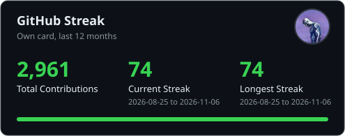

# Canoo Stats Cards

Static GitHub stats and contribution cards for a profile README, with no hosted service in the middle. A GitHub Action runs in your own repo and commits the cards as plain SVG files, so your README does not depend on a third party server staying up.





<p align="center">
  
</p>

<table>
  <tr>
    <td></td>
    <td>
      
      <br />
      
    </td>
  </tr>
</table>

<p align="center">
  
</p>

## What it makes

In your output directory, default `stats/`, pick the card types you want with the `cards` input:

- `stats.svg`: total stars, total commits (search total), total PRs, total issues, public repos, followers
- `top-langs.svg`: top 5 languages by code size, with a bar and percentages
- `tetris.svg`: your contribution graph as a vertical Tetris board, last 26 weeks. Blocks fall slowly, bottom row first, fill up, hold, then reset and loop again, 16 second cycle
- `contrib-3d.svg`: your contribution graph as a static isometric 3D strip, last 26 weeks
- `snake.svg`: a snake hunts your highest contribution days first, then the next highest, down to the lowest, moving only up, down, left, or right along the grid. Every time it eats a day, a new segment joins its body behind the head. Last 53 weeks
- `streak.svg`: total contributions, current streak, longest streak, last 12 months, with your GitHub avatar top right
- `summary.svg`: pie chart for commits, issues, PRs, reviews, and repos, alternating every 10 seconds with a pie chart of your top languages, plus a pentagon radar for the same five categories, and total contributions, stars, and forks. Transparent background, with your GitHub avatar top right

Cards are dark with a green accent. No icon wall, just numbers and languages. The snake, streak, and summary cards are original code by Canoo, inspired by Platane/snk, yoshi389111/github-profile-3d-contrib, and DenverCoder1/github-readme-streak-stats, with credit to those projects, not copies of them.

The avatar is fetched at generation time from your GitHub profile picture and embedded as base64 in the SVG, so at view time there is no external image to load. The snake and Tetris cards do not include an avatar.

## Use it as an action

Add this to a workflow in your profile repo, for example `.github/workflows/stats.yml`:

```yaml
name: Generate Stats Cards

on:
  schedule:
    - cron: "0 1 * * *"
  workflow_dispatch:

permissions:
  contents: write

jobs:
  generate:
    runs-on: ubuntu-latest
    timeout-minutes: 10
    steps:
      - uses: actions/checkout@v4
      - uses: canoo/github-stats-cards@v1
        with:
          cards: stats,top-langs,tetris,contrib-3d,snake,streak,summary
          github_token: ${{ secrets.GITHUB_TOKEN }}
      - name: Commit cards if changed
        run: |
          git config user.name "github-actions[bot]"
          git config user.email "github-actions[bot]@users.noreply.github.com"
          git add stats
          git diff --cached --quiet || git commit -m "Update stats cards"
          git push
```

Then embed the cards in your profile README:

```md


```

Run the workflow once manually after adding it, so the cards exist before anyone loads your profile. If you leave `cards` out, you get `stats` and `top-langs` only, the same as v1.0.0.

## Inputs

| Input | Default | What it does |
|---|---|---|
| `username` | Repository owner | GitHub username to generate cards for |
| `output_dir` | `stats` | Directory in the calling repo to write the cards to |
| `cards` | `stats,top-langs` | Comma-separated card types: stats, top-langs, tetris, contrib-3d, snake, streak, summary |
| `github_token` | Empty | Token for API calls. Pass `secrets.GITHUB_TOKEN` |

## Use it as a script

```sh
GITHUB_USER=octocat STATS_OUT=stats python3 generate_stats.py
```

No dependencies beyond Python 3 standard library.

## Limits, stated plainly

- With a workflow token, it counts public repos only. That token cannot see private repos.
- Commits, PRs and issues are GitHub search totals. Search can lag or cap totals, so they are labelled as search totals in the card where that matters.
- Forks are excluded, so the language card is not skewed by forked projects code.
- If you run it locally with a personal token that can read private repos, it will count the repos that token can read.

## License

MIT. See LICENSE.
